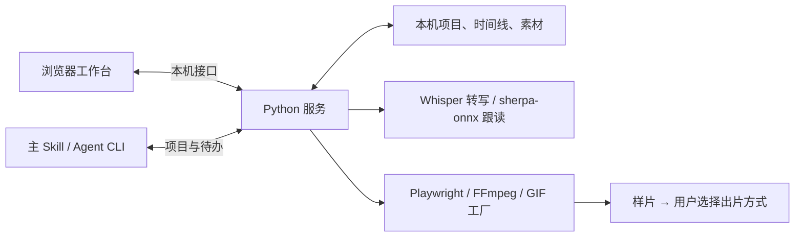

# 口播导演工作台 · Talking Head Studio

从稿件、提词和录制计划开始，把一条口播做成可发布的视频。你可以使用完整的三阶段流程，也可以从已有定稿或已经粗剪好的视频开始。

工作台与 Skill 版本为 **V3.7.0**。Windows 安装包和 macOS 磁盘映像包含首次启动所需的 Python 安装程序。已安装 Python 的创作者也可使用通用 Skill ZIP。

[下载安装包与 Skill](https://github.com/shynloc/talking-head-studio/releases/latest)

[功能](#功能) · [实现原理](#实现原理) · [安装部署](#安装部署) · [使用步骤](#使用步骤) · [与-agent-协作](#与-agent-协作) · [faq](#faq)

## 功能

| 阶段 | 可以做什么 |
| --- | --- |
| **1. 稿件与录制** | 首页可以从稿件、已有录音或视频、空白项目开始。Markdown 编辑器支持对比并采用 AI 建议。口播、展示、演示和停顿页可增删与排序，可给句子加制作标记。提词器支持整页适配、镜像、滚动、重录标记和可选的麦克风跟读。 |
| **2. 粗剪与校准** | 从实际录音转写，或导入已有字幕。根据静音和相似重录提出剪点，在确认前可以调整保留区间。已有粗剪可以直接采用，原素材文件保留。 |
| **3. 精剪与交付** | 在时间线上安排字幕、贴纸、动画、额外视频和声音。既可试看某个素材在口播里的效果，也可查看一段综合预览，再选 MP4、通用剪辑素材包、ChatCut 或剪映草稿。 |

## 实现原理



- **稿件、实际转写和字幕分开保存。** 提词页用页面和句子 ID 关联制作标记。前期用预计时间做编排，后期以实际转写和剪点映射为准，把标记校准到成片时间线。
- **粗剪记录保留和删除区间。** 渲染粗剪时根据记录读取原片，用户可以恢复被剪掉的片段。精剪则从当前主轨和辅助轨道重新合成。变更字幕、素材或剪辑后，旧样片的确认会失效。
- **从 HTML 渲染透明叠加层。** 内嵌 HTML Creator Studio 的帧函数驱动流程动画，Playwright 按帧截取画面，FFmpeg 合成视频、字幕和音轨。GIF 工厂轻动效把用户提供的 PNG 转为 GIF。
- **工作台在本机运行。** 服务默认监听 `127.0.0.1:8765`。项目、原片引用、导出和模型配置由本机管理。AI 润稿可以由用户选择的 Agent 领取待办，也可配置兼容的 Chat Completions 服务，将稿件发往指定模型。

## 安装部署

### Windows

下载文件名带 `windows-x64.zip` 的安装包，完整解压并双击「安装并打开工作台.cmd」。首次安装可能需要几分钟。打开浏览器后点「有稿件」即可开始。以后从开始菜单打开「口播导演工作台」。

### macOS

打开 DMG，把「口播导演工作台」拖入「应用程序」并打开。如果需要 Python，跟随系统安装窗口操作。标有 `macos-preview` 的映像是本地签名预览构建，Developer ID 签名与 Apple 公证的版本使用 `macos.dmg` 文件名。系统阻止预览版时，可使用通用 ZIP 并从解压目录运行 `/bin/bash ./install_macos.command`。

### 通用 ZIP

下载不带平台后缀的 ZIP，适用于安装 Agent Skill 或自行运行源码。这个包需要已有 Python 3.10–3.13。Windows 可双击「安装工作台.cmd」，macOS 可打开「install_macos.command」。缺少 FFmpeg 时可先写稿提词；想处理录像时，工作台可以调用本机 winget 或 Homebrew 准备视频组件。

<details><summary>准备视频工具和其他安装方式</summary>

处理视频需要完整 FFmpeg（含 ffprobe、libass、libx264）。Windows 可运行 `winget install --exact --id Gyan.FFmpeg`。已安装 Homebrew 的 Mac 可运行 `brew install ffmpeg-full`。装好后再次运行同一个工作台安装器，它会补全视频依赖、安装 Chromium 并检查实际编码。macOS 也可以从解压目录运行 `/bin/bash ./install_macos.command`。

</details>

### 更新旧版

下载并完整解压新 ZIP，从新目录运行和首次安装一样的入口。默认应用安装位置和项目数据目录与原来相同。若旧版本使用了自定义项目目录，请在首次升级时传入原来的 `--data` 和 `--port`，后续安装会记住它们。旧应用代码会备份到应用目录旁的 `backups`。若有文件或任务正在处理，请等它结束后再运行安装器。

```powershell
.\安装工作台.cmd --data "D:\TalkingHeadStudio" --port 8767
```

默认项目目录都是 `Documents/TalkingHeadStudio`。独立应用代码和项目数据可分别指定。端口冲突时可传入 `--port 0` 自动选空闲端口。同一数据目录由一个工作台服务使用。要停止独立工作台，用安装后提供的应用 Python 运行安装目录的 `scripts/launch.py --data <项目目录> --stop`。

### 安装或更新 Codex Skill

独立工作台的用户可以另外安装 Skill。Windows 双击「安装更新Skill.cmd」，macOS 在解压目录运行 `python3.12 -X utf8 scripts/install.py`。已启动的独立工作台可以直接继续用。只登记 Skill 时，可给脚本加 `--no-launch`。Skill 安装到 Codex 的 `skills/talking-head-studio` 目录，并将旧版备份到项目目录里的 `install-backups`。安装后重新打开 Codex，使用 `$talking-head-studio` 调用。

从旧版 Skill 转到独立工作台时，先停止旧工作台，再把同一项目目录传给独立安装入口。Windows 的 V2.0.2 如果在运行，可先用新版的「安装更新Skill.cmd」更新旧服务。

### 源码运行

开发或试用时也可在解压后的目录自行创建 Python 环境，运行 `scripts/setup.py --install --smoke` 和 `scripts/launch.py`。可选组件应安装到运行工作台的同一个 Python 环境。安装器会显示「应用 Python」的完整路径。

### 按需启用

| 功能 | 如何启用 |
| --- | --- |
| 录音转写与自动字幕 | 运行 `.\.venv\Scripts\python.exe scripts/setup.py --speech` 安装 Whisper。在工作台转写时选择模型，并允许首次下载。已有 SRT 也可直接导入。 |
| 麦克风跟读 | 运行 `.\.venv\Scripts\python.exe scripts/setup_speech.py`，约下载 190 MiB 中文/英文流式模型。自定义了项目目录时，给这条命令传入相同的 `--data`。安装好后可本地识别。 |
| AI 润稿与语义分页 | 默认提交 Codex 待办，由 Agent 领取。也可在首页配置自己的 Chat Completions 地址、模型和密钥。手动编辑和基础规则排页可以直接使用。 |
| GIF 工厂轻动效 | 随仓库提供所需导出器。第三阶段导入透明 PNG，再生成 GIF。 |
| HTML Creator Studio | 授权嵌入文档提取与逐帧动画模块，无需另行安装。安装了 `pdftotext` 时使用 HTML Creator Studio 的 PDF 路径，否则使用内置 pypdf 提取。 |
| 剪映草稿 | 运行 `.\.venv\Scripts\python.exe -m pip install pyJianYingDraft==0.3.1`。Windows 剪映专业版 11.8 已实测打开、保存和重新导出。其他版本与 macOS 待验收。 |
| 用 ChatCut 继续剪 | 安装并启动 ChatCut 桌面版，连接 Codex 或 WorkBuddy 的本地 ChatCut 工具。 [ChatCut 桌面 Agent 指南](https://chatcut.io/docs/desktop-agent-workflows) |

Whisper 用于录制后的转写。提词器的实时跟读使用另一套本地模型，可以分别安装。

## 使用步骤

首页按手头的素材分为「有稿件」「有录音或视频」「从空白开始」。点「继续创作」回到上次的项目和步骤，示例可以单独展开。

### 1. 写稿与录制

选择文件或粘贴稿件，检查分页预览，点「使用这些提词页」。在项目里可以调整页序、补画面备注。想改稿时点「想先润色稿件？」。使用 Codex 待办时可先用现稿，返回的建议由你决定是否采用。

点「打开提词器」，先在手机或相机上开始录像。右方向键或向前按钮先读下一屏，本页读完再翻页。需要时打开自动滚动或「跟我读」。最后点「录好了，导入视频」。

### 2. 整理视频

原始录像选「帮我去掉长停顿」。听原片或剪后版本，可逐处保留，满意后点「用这版做字幕」。已有剪好的视频选「直接用这个视频」，直接进入下一步。录音文件可以识别成文字后转为提词页。

### 3. 字幕与导出

点「自动加字幕」或导入已有字幕。逐句试听、改字，在「这里加画面」中选择放图片、放演示、强调文字或加声音。需要拖动位置和调整多轨时再展开「精细调整」。

点「看成片效果」自动准备当前预览，已有有效预览可直接播放。「换一段预览」可以指定位置。「导出 MP4」保存完整视频，「用剪辑软件继续」展开外部剪辑入口。

| 出片方式 | 之后还能改什么 |
| --- | --- |
| **直接导出完整视频** | 生成可发布的 MP4。要继续改字幕、音乐或动画内部，在工作台编辑后重新导出。 |
| **下载剪辑素材包** | 解压后按「打开素材包.md」导入。原素材、主画面、SRT、透明 MOV、独立音频和摆放时间表分开放。可在支持这些格式的编辑器里组装。 |
| **用 ChatCut 继续剪** | 点「存为剪辑待办」，把任务卡交给已连接 ChatCut 的 AI 助手。Windows 的 Codex 和 WorkBuddy 都已在 ChatCut 0.10.2 用本机工具实测组装、保存和导出，可继续剪主画面、改字幕、移动透明动画和调整音量。 |
| **生成剪映草稿** | 下载并解压，按包内「打开草稿.md」放到剪映专业版的草稿位置，再在剪映里继续剪。Windows 版剪映 11.8 实测确认字幕和声音可分开改，两个透明动画是独立片段。 |

外部编辑器里的透明动画可以移动、缩放和裁短，内部文字和关键帧在工作台改。更换编辑器时可参照预览，调整字幕外观和背景乐自动避让。ChatCut 和剪映由各自的导出设置决定分辨率。

继续修改时，重新生成与当前时间线对应的样片。点击顶部「打包工程」可导出稿件、字幕、轨道和素材。跨电脑继续剪辑时，勾选「同时打包当前原片和已有粗剪文件」。使用轻量包时，请在目标工作台重新关联原片。

### 使用自己的助手

在项目顶栏点「交给 AI」，选择助手、写要求、选择随任务带出的稿件或字幕。交给 ChatGPT、Grok 或「其他助手」时，可复制所选内容，回到工作台粘贴结果。工作台不会将原片附在任务卡上。

| 助手 | 如何接着原对话做 | 从新对话开始 |
| --- | --- | --- |
| Codex | 绑定过的项目可投递到已核验的会话 ID，失败时保留待办。 | 在项目目录启动新的 Codex，再粘贴任务卡。 |
| Claude Code | 在「选择原对话或新对话」记住会话 ID，按提示在项目目录执行 `claude --resume ID`。 | 启动 `claude` 后粘贴任务卡。 |
| Claude 客户端、ChatGPT、Grok Bot | 记住当前项目对应的私有对话网址。回到同一账号打开链接，再粘贴所选资料。 | 从指定服务的新对话入口打开。 |
| WorkBuddy、TRAE、TraeWork、其他助手 | 把任务卡粘贴进选定的原聊天。本机可用 CLI 或 MCP 时可以直接领取和回写。 | 在该应用点新对话，粘贴同一任务卡。 |

Claude Code、Claude 客户端及支持本地 stdio MCP 的编辑器，可运行 `python scripts/studio.py agent-config --agent claude-code` 获取当前电脑绝对路径的 MCP 配置。将助手名分别替换为 `claude-desktop`、`workbuddy`、`trae` 或 `traework`。使用自定义端口时，在子命令前传入 `--url http://127.0.0.1:端口`。工作台只在本机保存原对话地址。关于会话 ID 可参考 [Claude Code CLI](https://code.claude.com/docs/en/cli-reference)。

## 与 Agent 协作

本仓库根目录包含 [主 Skill](SKILL.md)。你可以直接使用浏览器工作台，也可以把整个仓库作为本地 Skill 安装到 Codex，并保持本机工作台运行。

### 把项目交给 Codex 或 WorkBuddy

1. 在项目上方点「交给 AI」，选 Codex 或 WorkBuddy，写下要处理的事，存为待办。
2. 点「复制任务卡」，粘贴到要继续的原对话。能访问本机工作台的 Agent 可以领取、读取任务当时的稿件和字幕，再把文字建议写回来。工具连不上时，可直接在原对话继续，回来点「粘贴 AI 的结果」保存。
3. 回首页的「AI 待办」查看结果。建议供你校对并复制使用。项目在这期间有改动时会提示先对照当前版本。

Codex 用户还可点「连接 Codex 原对话」，把连接指令粘贴到项目原来的 Codex 对话。核验成功后可点「继续原对话」，把任务排入该会话。排队后可打开原对话查看，等 Agent 实际领取才显示「AI 已领取」。WorkBuddy 可在原对话粘贴任务卡。只有工作台本机可访问的项目内容才会交给 Agent 工具。

### 可选的本机工具连接

任务卡包含可供 Agent 执行的终端命令。也可以将 `scripts/agent_mcp.py` 配置为 stdio MCP，命令使用工作台的 Python，参数如下。Codex 选 `codex`，WorkBuddy 选 `workbuddy`。使用自定义端口时替换地址。 [WorkBuddy MCP 配置](https://www.codebuddy.cn/docs/workbuddy/From-Beginner-to-Expert-Guide/Function-Description/MCP-Guide)

```text
/绝对路径/scripts/agent_mcp.py --agent workbuddy --url http://127.0.0.1:8765
```

稿件编辑器中原有的润稿和分页建议也可继续使用。提交这类待办后，可在 Codex 聊天内让它处理，再回到稿件编辑器确认采用。

```powershell
.\.venv\Scripts\python.exe scripts/studio.py status
.\.venv\Scripts\python.exe scripts/studio.py agent-list --agent codex
.\.venv\Scripts\python.exe scripts/studio.py drafts
.\.venv\Scripts\python.exe scripts/studio.py --help
```

使用自定义端口时，把 `--url http://127.0.0.1:8767` 放在子命令之前。项目编号与任务编号由 CLI 返回。

## FAQ

### 没有模型密钥，能工作吗？

可以手动编稿、用规则分页、编辑时间线，并用已有字幕出片。AI 润稿可以由当前 Agent 处理待办；本地转写和实时跟读各自使用本地模型。

### 麦克风有音量，但文字不亮怎么办？

先检查跟读模型是否安装，然后在「麦克风与语音测试」里选择实际使用的设备并试读一句。若内嵌浏览器无法采集，改用 Edge 或 Chrome 打开工作台的本机网址。长段稿件可手动定位或翻页。

### 为何不能直接点「导出成片」？

点「看成片效果」会自动准备当前预览。改过剪点时，就地更新剪辑预览并试听。遇到待补画面时，可以选择文件，也可以在本次导出中略过。满意后点「导出 MP4」。

### 我的原片会被覆盖或上传吗？

工作台生成新的粗剪和成片文件，原素材保留在本机。使用外部模型服务进行润稿或分页时，提交的稿件会发送至自行配置的服务地址。使用其他 Agent 的在线工具时，按需明确选择要交接的资料。

### 已经有精剪软件，能继续在那里编辑吗？

可以下载「剪辑素材包」，在你的软件里按时间表摆放字幕、动效和声音。已配置 ChatCut 的用户可以交给助手搭建可编辑项目。剪映专业版用户可以选择草稿。

### 换一台 Windows 或 Mac，怎样带走整个项目？

点项目顶部的「打包工程」，勾选「同时打包当前原片和已有粗剪文件」。在另一台电脑打开工作台首页，从导入工程入口选择 ZIP。字幕、稿件、时间线与带进包里的素材会一起恢复。迁移后生成一段新样片，检查后再导出。较早的轻量工程包要在新电脑重新关联原片。

### 装完后找不到项目，或者提示端口被占用？

确认打开的是原来的项目目录。以前用过 `--data` 的，请继续传入同一个路径。如果两个工作台入口都在运行，先从原入口停止使用该目录的实例。其他程序占用端口时可用 `--port 0`。服务日志保存在项目目录的 `server.stderr.log`。macOS 启动入口另写入 `launcher.log`。

### WorkBuddy 怎么把任务交给 ChatCut？

先在同一台电脑打开 ChatCut 桌面版，并连接 WorkBuddy 的本机 ChatCut 工具。在工作台的预览后选「用 ChatCut 继续剪」，选择 WorkBuddy，把任务卡粘贴回原对话。WorkBuddy 领取后读取本机素材与时间线，完成后可把 ChatCut 项目名和 ID 写回待办。如果缺少本机 ChatCut 工具，可保留待办和素材包，连接后再试。 [ChatCut 官方 WorkBuddy 指南](https://chatcut.io/workbuddy)

### 这次实测了哪些电脑和功能？

V3.7 的 Windows 浏览器验收用了真实口播节选和配套字幕。由录前备注先试文字、再把 PNG 做成动图，只在采用后写入时间线。随后生成从中段开始的短预览，改当前字幕、替换画面并导出；同一段视频也从「已经剪好，只加字幕」直接导出。两份 MP4 均已完整解码。

| 环境 | 已实测 | 待实测 |
| --- | --- | --- |
| Windows x64 | 全新环境用安装包内的 Python 启动工作台。ZIP 安装和升级、中文渲染、三阶段与工程迁移均已跑通。本机用 Whisper 转写中文后完成粗剪、校字幕和导出。C920 实体麦克风有输入电平，识别服务已连接，停止后释放设备。 | 其他麦克风型号和用户的实际录音环境。 |
| macOS 15 Apple 芯片 | 在 GitHub Mac 虚拟机挂载 DMG，安装随包的 Python，从映像运行应用并读取工作台版本。通用 ZIP 另测了升级、三阶段和工程迁移，使用带时间戳的测试素材完成实际剪切与编码。 | 实体 Mac 的 Finder 首启、麦克风授权与跟读、本机 Whisper、ChatCut 和剪映。 |
| Intel Mac 和 Windows 11 ARM | 两种架构的虚拟机均已从稿件创建项目并导出独立 HTML 提词页。 | 原生安装包的完整安装体验和视频三阶段。Windows 桌面包目标为 x64。 |
| Windows 上的 WorkBuddy 与 ChatCut | V3.5 在 WorkBuddy 原对话领取待办，在 ChatCut 装配主画面、字幕、两条透明动画和独立音效，改字、保存、导出 MP4 并回写。V3.6 另测了工作台待办、回写与交接包。 | Mac 上的相同组合、其他客户端版本。 |

Windows 与 Apple 芯片 macOS 可以用完整工程 ZIP 互相迁移，并从随包的原片重新渲染。当前发行的 macOS 安装包为本地签名的预览 DMG，尚未取得 Apple Developer ID 公证。 [V3.6 验收运行](https://github.com/shynloc/talking-head-studio/actions/runs/44983980291) · [V3.5 验收运行](https://github.com/shynloc/talking-head-studio/actions/runs/44946232710)

### 怎样从正在看的那句话开始改？

在「看成片效果」中暂停。点「改这句字幕」改字，或用「调整这里的画面」替换、移除或加入图片、视频和强调文字。保存后工作台从这句话之前重新生成短预览。在无字幕的空隙可以调整画面，播放到说话处即可改字。

### 录制前留的画面备注在哪里？

写稿时展开「加画面备注」，为一句口播选类型、填写内容。生成字幕后，能对应到口播的备注会出现在那句字幕旁。点「试看」看实际短片，再选「采用」「换一个」或「跳过」。漏说、重复或改词导致定位不准时，先选一句。可选已导入的图片、视频或声音，用 PNG 做轻动图，或试步骤动画及文字提示。单独的「录制提醒」供录制者阅读。

### 已经剪好、只想加字幕怎么办？

在导入窗口选择「已经剪好，只加字幕」，然后选文件。导入后直接到字幕页，识别或导入字幕并试看即可导出。只加字幕保留主画面与原声，隐藏额外画面和配乐。在字幕页取消勾选可恢复完整编排。

## 第三方组件

- [GIF 工厂](https://github.com/WoYun520/gif-factory) 的轻动效导出器，保留 [MIT 许可](vendor/gif-factory/LICENSE)。
- [Vditor](https://github.com/Vanessa219/vditor) 的本地静态资源，保留 [MIT 许可](assets/workbench/vendor/vditor/LICENSE) 及其分发文件中的第三方声明。
- HTML Creator Studio 核心模块经维护者授权嵌入，来源和版本见 [NOTICE](vendor/html-creator-studio-core/NOTICE)。
- 字幕、GIF、流程卡片和提词器使用随工程分发的 Noto Sans CJK SC。字体来源见 [NOTICE](assets/workbench/fonts/NOTICE)，许可见 [OFL 1.1](assets/workbench/fonts/OFL.txt)。分享离线提词时请使用完整 ZIP。
- Whisper 模型、sherpa-onnx 模型、FFmpeg 和 Chromium 按需从各自渠道安装。

第三方组件的许可适用于对应文件。主项目的源码公开可查看，主项目许可由维护者另行声明。


### 如何重新制作系统安装包？

从已提交的发行源码运行 `python scripts/package_release.py --output dist`，再运行 `python packaging/build_installers.py windows --archive dist/talking-head-studio-v3.7.0.zip --out native`。Mac 构建时将平台参数改为 `macos`。构建器使用 Python 官方安装程序及固定 SHA-256。Mac 应用包含 Intel 和 Apple 芯片可执行文件。[Python 安装程序来源](https://www.python.org/downloads/release/python-31314/)

有 Developer ID 的发布者可在 Mac 钥匙串中配置签名身份和 notarytool 配置，构建时提供 `--identity` 与 `--notary-profile`。发布流程会分别签署应用和磁盘映像，等待 Apple 接受并附加公证票据。GitHub Actions 可通过仓库 Secrets 配置相同流程。[Apple 公证说明](https://developer.apple.com/documentation/security/notarizing-macos-software-before-distribution)
