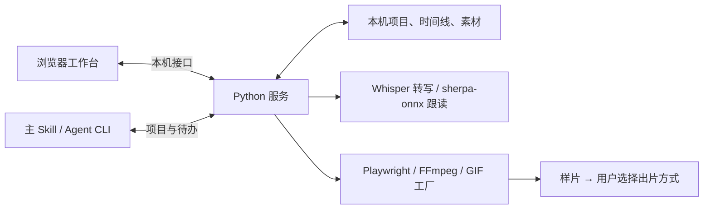

# 口播导演工作台 · Talking Head Studio

从稿件、提词和录制计划开始，把一条口播做成可发布的视频。你可以使用完整的三阶段流程，也可以从已有定稿或已经粗剪好的视频开始。

最新版本为 **V3.5.0**。安装时下载 GitHub Release 的工作台与 Skill 通用 ZIP。工程、成片和模型均存放在本机指定的数据目录。

[下载 V3.5.0](https://github.com/shynloc/talking-head-studio/releases/tag/v3.5.0)

[功能](#功能) · [实现原理](#实现原理) · [安装部署](#安装部署) · [使用步骤](#使用步骤) · [与-agent-协作](#与-agent-协作) · [faq](#faq)

## 功能

| 阶段 | 可以做什么 |
| --- | --- |
| **1. 稿件与录制** | Dashboard 提供导入已有稿件、AI 稿件润色和新建项目。Markdown 编辑器支持对比并采用 AI 建议。口播、展示、演示和停顿页可增删与排序，可给句子加制作标记。提词器支持整页适配、镜像、滚动、重录标记和可选的麦克风跟读。 |
| **2. 粗剪与校准** | 从实际录音转写，或导入已有字幕。根据静音和相似重录提出剪点，在确认前可以调整保留区间。已有粗剪可以直接采用，原素材文件保留。 |
| **3. 精剪与交付** | 在时间线上安排字幕、贴纸、动画、额外视频和声音。既可试看某个素材在口播里的效果，也可查看一段综合预览，再选 MP4、通用剪辑素材包、ChatCut 或剪映草稿。 |

## 实现原理



- **稿件、实际转写和字幕分开保存。** 提词页用页面和句子 ID 关联制作标记。前期用预计时间做编排，后期以实际转写和剪点映射为准，把标记校准到成片时间线。
- **粗剪记录保留和删除区间。** 渲染粗剪时根据记录读取原片，用户可以恢复被剪掉的片段。精剪则从当前主轨和辅助轨道重新合成。变更字幕、素材或剪辑后，旧样片的确认会失效。
- **从 HTML 渲染透明叠加层。** 内嵌 HTML Creator Studio 的帧函数驱动流程动画，Playwright 按帧截取画面，FFmpeg 合成视频、字幕和音轨。GIF 工厂轻动效把用户提供的 PNG 转为 GIF。
- **工作台在本机运行。** 服务默认监听 `127.0.0.1:8765`。项目、原片引用、导出和模型配置由本机管理。AI 润稿可以由用户选择的 Agent 领取待办，也可配置兼容的 Chat Completions 服务，将稿件发往指定模型。

## 安装部署

先到 [GitHub Releases](https://github.com/shynloc/talking-head-studio/releases) 下载 `talking-head-studio-v3.5.0.zip` 并完整解压。Release 同时提供 SHA-256 校验文件。工作台会为当前用户创建独立的 Python 环境，首次安装需要联网下载依赖和 Chromium。

### Windows

1. 安装 [Python 3.12](https://www.python.org/downloads/) 并勾选添加到 PATH。安装完整 FFmpeg，可在终端运行 `winget install --exact --id Gyan.FFmpeg`。安装后重新打开终端确认 `python --version` 和 `ffmpeg -version` 可用。
2. 双击解压目录里的「安装工作台.cmd」。第一次需要等待安装器下载依赖、检测中文字体和实际渲染一段视频。
3. 安装完成会打开浏览器。以后从开始菜单搜索「口播导演工作台」即可启动。

### macOS

在已经安装 Homebrew 的 Mac 上，先安装 Python 和完整 FFmpeg。

```bash
brew install python@3.12 ffmpeg-full
```

进入解压出的 `talking-head-studio` 目录，然后在终端运行安装脚本。

```bash
/bin/bash ./install_macos.command
```

安装后可从 Finder 中的 `~/Applications` 打开「口播导演工作台.app」。应用代码默认在 `~/Library/Application Support/TalkingHeadStudio`。需要从终端启动时可运行解压目录的 `launch_macos.command`。

### 更新旧版

下载并完整解压新 ZIP，从新目录运行和首次安装一样的入口。默认应用安装位置和项目数据目录与原来相同。若旧版本使用了自定义项目目录，请在首次升级时传入原来的 `--data` 和 `--port`，后续安装会记住它们。旧应用代码会备份到应用目录旁的 `backups`。若有文件或任务正在处理，请等它结束后再运行安装器。

```powershell
.\安装工作台.cmd --data "D:\TalkingHeadStudio" --port 8767
```

默认项目目录都是 `Documents/TalkingHeadStudio`。独立应用代码和项目数据可分别指定。端口冲突时可传入 `--port 0` 自动选空闲端口。同一数据目录由一个工作台服务使用。要停止独立工作台，用安装后提供的应用 Python 运行安装目录的 `scripts/launch.py --data <项目目录> --stop`。

### 安装或更新 Codex Skill

独立工作台的用户可以另外安装 Skill。Windows 双击「安装更新Skill.cmd」，macOS 在解压目录运行 `python3.12 -X utf8 scripts/install.py`。已启动的独立工作台可以直接继续用。只登记 Skill 时，可给脚本加 `--no-launch`。Skill 安装到 Codex 的 `skills/talking-head-studio` 目录，并将旧版备份到项目目录里的 `install-backups`。安装后重新打开 Codex，使用 `$talking-head-studio` 调用。

从旧版 Skill 转到独立工作台时，先停止旧工作台，再把同一项目目录传给独立安装入口。Windows 的 V2.0.2 如果在运行，可先用新版的「安装更新Skill.cmd」更新旧服务。

### 源码运行

开发或试用时也可在解压后的目录自行创建 Python 环境，运行 `scripts/setup.py --install --smoke` 和 `scripts/launch.py`。可选组件应安装到运行工作台的同一个 Python 环境。安装器会显示「应用 Python」的完整路径。

### 按需启用

| 功能 | 如何启用 |
| --- | --- |
| 录音转写与自动字幕 | 运行 `.\.venv\Scripts\python.exe scripts/setup.py --speech` 安装 Whisper。在工作台转写时选择模型，并允许首次下载。已有 SRT 也可直接导入。 |
| 麦克风跟读 | 运行 `.\.venv\Scripts\python.exe scripts/setup_speech.py`，约下载 190 MiB 中文/英文流式模型。自定义了项目目录时，给这条命令传入相同的 `--data`。安装好后可本地识别。 |
| AI 润稿与语义分页 | 默认提交 Codex 待办，由 Agent 领取。也可在首页配置自己的 Chat Completions 地址、模型和密钥。手动编辑和基础规则排页可以直接使用。 |
| GIF 工厂轻动效 | 随仓库提供所需导出器。第三阶段导入透明 PNG，再生成 GIF。 |
| HTML Creator Studio | 授权嵌入文档提取与逐帧动画模块，无需另行安装。安装了 `pdftotext` 时使用 HTML Creator Studio 的 PDF 路径，否则使用内置 pypdf 提取。 |
| 剪映草稿 | 运行 `.\.venv\Scripts\python.exe -m pip install pyJianYingDraft==0.3.1`。Windows 剪映专业版 11.8 已实测打开、保存和重新导出。其他版本与 macOS 待验收。 |
| 用 ChatCut 继续剪 | 安装并启动 ChatCut 桌面版，连接 Codex 或 WorkBuddy 的本地 ChatCut 工具。 [ChatCut 桌面 Agent 指南](https://chatcut.io/docs/desktop-agent-workflows) |

Whisper 用于录制后的转写。提词器的实时跟读使用另一套本地模型，可以分别安装。

## 使用步骤

首页可以选现有稿件、AI 润稿或新建项目。已经录好的人可以点「从视频开始」，直接进入第二步。项目会记住上次停留的步骤。

### 1. 写稿与录制

导入已有稿件后可点「用现稿分页」，也可以等 AI 提供润稿或分页建议。在每页的「画面备注」写下将来要插入的演示、贴纸或动画。需要精确安排时，展开底部时间线。

点击「打开提词器」，用翻页或定速滚动配合外部相机录制。需要跟读时，可以先点「测试麦克风」，再在提词器中开启语音跟随。长稿可用全屏或「下一屏」继续读。

### 2. 整理视频

导入录制后，按实际情况选择「查找长停顿」或「已经剪好，直接用这版」。查找后可勾选要保留的片段，生成预览并确认。只导入一段录音时，可以先识别文字，再用来写稿。

### 3. 字幕与导出

可以「识别视频里的说话」，也可以导入对应这条视频的字幕文件。生成字幕后，点击「检查字幕」改字。素材、位置、时长和音量等操作可在展开后的时间线里调整。只想先看画面也可以选「暂不加字幕，去预览」。

点「试看动画与音效」选择素材，看看它和口播、字幕合在一起的效果。也可以点「预览与导出」看一小段，展开「挑选要预览的片段」可指定位置。看完选择出片方式，所有方式都使用当前的完整时间线。

| 出片方式 | 之后还能改什么 |
| --- | --- |
| **直接导出完整视频** | 生成可发布的 MP4。要继续改字幕、音乐或动画内部，在工作台编辑后重新导出。 |
| **下载剪辑素材包** | 解压后按「打开素材包.md」导入。原素材、主画面、SRT、透明 MOV、独立音频和摆放时间表分开放。可在支持这些格式的编辑器里组装。 |
| **用 ChatCut 继续剪** | 点「存为剪辑待办」，把任务卡交给已连接 ChatCut 的 AI 助手。Windows 的 Codex 和 WorkBuddy 都已在 ChatCut 0.10.2 用本机工具实测组装、保存和导出，可继续剪主画面、改字幕、移动透明动画和调整音量。 |
| **生成剪映草稿** | 下载并解压，按包内「打开草稿.md」放到剪映专业版的草稿位置，再在剪映里继续剪。Windows 版剪映 11.8 实测确认字幕和声音可分开改，两个透明动画是独立片段。 |

外部编辑器里的透明动画可以移动、缩放和裁短，内部文字和关键帧在工作台改。更换编辑器时可参照预览，调整字幕外观和背景乐自动避让。ChatCut 和剪映由各自的导出设置决定分辨率。

继续修改时，重新生成与当前时间线对应的样片。点击顶部「打包工程」可导出稿件、字幕、轨道和素材。跨电脑继续剪辑时，勾选「同时打包当前原片和已有粗剪文件」。使用轻量包时，请在目标工作台重新关联原片。

## 与 Agent 协作

本仓库根目录包含 [主 Skill](SKILL.md)。你可以直接使用浏览器工作台，也可以把整个仓库作为本地 Skill 安装到 Codex，并保持本机工作台运行。

### 把项目交给 Codex 或 WorkBuddy

1. 在项目上方点「交给 AI」，选 Codex 或 WorkBuddy，写下要处理的事，存为待办。
2. 点「复制任务卡」，粘贴到要继续的原对话。能访问本机工作台的 Agent 可以领取、读取任务当时的稿件和字幕，再把文字建议写回来。工具连不上时，可直接在原对话继续，回来点「粘贴 AI 的结果」保存。
3. 回首页的「AI 待办」查看结果。建议供你校对并复制使用。项目在这期间有改动时会提示先对照当前版本。

Codex 用户还可点「连接 Codex 原对话」，把连接指令粘贴到项目原来的 Codex 对话。核验成功后可点「继续原对话」，把任务排入该会话。排队后可打开原对话查看，等 Agent 实际领取才显示「AI 已领取」。WorkBuddy 可在原对话粘贴任务卡。只有工作台本机可访问的项目内容才会交给 Agent 工具。

### 可选的本机工具连接

任务卡包含可供 Agent 执行的终端命令。也可以将 `scripts/agent_mcp.py` 配置为 stdio MCP，命令使用工作台的 Python，参数如下。Codex 选 `codex`，WorkBuddy 选 `workbuddy`。使用自定义端口时替换地址。 [WorkBuddy MCP 配置](https://www.codebuddy.cn/docs/workbuddy/From-Beginner-to-Expert-Guide/Function-Description/MCP-Guide)

```text
/绝对路径/scripts/agent_mcp.py --agent workbuddy --url http://127.0.0.1:8765
```

稿件编辑器中原有的润稿和分页建议也可继续使用。提交这类待办后，可在 Codex 聊天内让它处理，再回到稿件编辑器确认采用。

```powershell
.\.venv\Scripts\python.exe scripts/studio.py status
.\.venv\Scripts\python.exe scripts/studio.py agent-list --agent codex
.\.venv\Scripts\python.exe scripts/studio.py drafts
.\.venv\Scripts\python.exe scripts/studio.py --help
```

使用自定义端口时，把 `--url http://127.0.0.1:8767` 放在子命令之前。项目编号与任务编号由 CLI 返回。

## FAQ

### 没有模型密钥，能工作吗？

可以手动编稿、用规则分页、编辑时间线，并用已有字幕出片。AI 润稿可以由当前 Agent 处理待办；本地转写和实时跟读各自使用本地模型。

### 麦克风有音量，但文字不亮怎么办？

先检查跟读模型是否安装，然后在「麦克风与语音测试」里选择实际使用的设备并试读一句。若内嵌浏览器无法采集，改用 Edge 或 Chrome 打开工作台的本机网址。长段稿件可手动定位或翻页。

### 为何不能直接点「导出成片」？

按「预览与导出」里当时的提示准备视频或补素材。生成预览并在同一窗口确认后，即可导出完整视频。改过字幕、片段或画面后，先生成一段新的预览。

### 我的原片会被覆盖或上传吗？

工作台生成新的粗剪和成片文件，原素材保留在本机。使用外部模型服务进行润稿或分页时，提交的稿件会发送至自行配置的服务地址。使用其他 Agent 的在线工具时，按需明确选择要交接的资料。

### 已经有精剪软件，能继续在那里编辑吗？

可以下载「剪辑素材包」，在你的软件里按时间表摆放字幕、动效和声音。已配置 ChatCut 的用户可以交给助手搭建可编辑项目。剪映专业版用户可以选择草稿。

### 换一台 Windows 或 Mac，怎样带走整个项目？

点项目顶部的「打包工程」，勾选「同时打包当前原片和已有粗剪文件」。在另一台电脑打开工作台首页，从导入工程入口选择 ZIP。字幕、稿件、时间线与带进包里的素材会一起恢复。迁移后生成一段新样片，检查后再导出。较早的轻量工程包要在新电脑重新关联原片。

### 装完后找不到项目，或者提示端口被占用？

确认打开的是原来的项目目录。以前用过 `--data` 的，请继续传入同一个路径。如果两个工作台入口都在运行，先从原入口停止使用该目录的实例。其他程序占用端口时可用 `--port 0`。服务日志保存在项目目录的 `server.stderr.log`。macOS 启动入口另写入 `launcher.log`。

### WorkBuddy 怎么把任务交给 ChatCut？

先在同一台电脑打开 ChatCut 桌面版，并连接 WorkBuddy 的本机 ChatCut 工具。在工作台的预览后选「用 ChatCut 继续剪」，选择 WorkBuddy，把任务卡粘贴回原对话。WorkBuddy 领取后读取本机素材与时间线，完成后可把 ChatCut 项目名和 ID 写回待办。如果缺少本机 ChatCut 工具，可保留待办和素材包，连接后再试。 [ChatCut 官方 WorkBuddy 指南](https://chatcut.io/workbuddy)

### 这次实测了哪些电脑和功能？

| 环境 | 已实测 | 待实测 |
| --- | --- | --- |
| Windows x64 | Windows 11 本机和 GitHub 全新 Windows 虚拟机验证了 ZIP 安装、升级、中文渲染、三阶段及工程导入后出样片。本机还用 Whisper medium 转写中文录音、完成粗剪与成片，并验证 V2.0.2 Skill 升级后保留工程。 | Windows ARM64。 |
| macOS 15 ARM64 | GitHub Apple Silicon 虚拟机验证了 ZIP 安装、`.app` 启动脚本、旧工程升级、同目录应用重装、中文渲染和三阶段。三阶段使用已知时间戳，运行了实际静音分析、粗剪和视频编码。 | 实体 Mac 上通过 Finder 打开、物理麦克风、Whisper 转写、Mac Intel、剪映和 ChatCut 桌面联测。 |
| Windows 上的 WorkBuddy 与 ChatCut | WorkBuddy 在原测试对话领取待办。在 ChatCut 本机组装主画面、字幕、两条透明动画和独立音效，改字后保存并导出 MP4，再将项目 ID 写回工作台。 | Mac 上的相同组合、其他客户端版本。 |

Windows 与 macOS 的完整工程 ZIP 跨平台往返后，均已从随包的原片重新渲染样片。Mac 当前通过 ZIP 安装。签名公证的 DMG 待提供。 [V3.5 自动验收记录](https://github.com/shynloc/talking-head-studio/actions/runs/44946232710)

## 第三方组件

- [GIF 工厂](https://github.com/WoYun520/gif-factory) 的轻动效导出器，保留 [MIT 许可](vendor/gif-factory/LICENSE)。
- [Vditor](https://github.com/Vanessa219/vditor) 的本地静态资源，保留 [MIT 许可](assets/workbench/vendor/vditor/LICENSE) 及其分发文件中的第三方声明。
- HTML Creator Studio 核心模块经维护者授权嵌入，来源和版本见 [NOTICE](vendor/html-creator-studio-core/NOTICE)。
- 字幕、GIF、流程卡片和提词器使用随工程分发的 Noto Sans CJK SC。字体来源见 [NOTICE](assets/workbench/fonts/NOTICE)，许可见 [OFL 1.1](assets/workbench/fonts/OFL.txt)。分享离线提词时请使用完整 ZIP。
- Whisper 模型、sherpa-onnx 模型、FFmpeg 和 Chromium 按需从各自渠道安装。

第三方组件的许可适用于对应文件。主项目的源码公开可查看，主项目许可由维护者另行声明。
